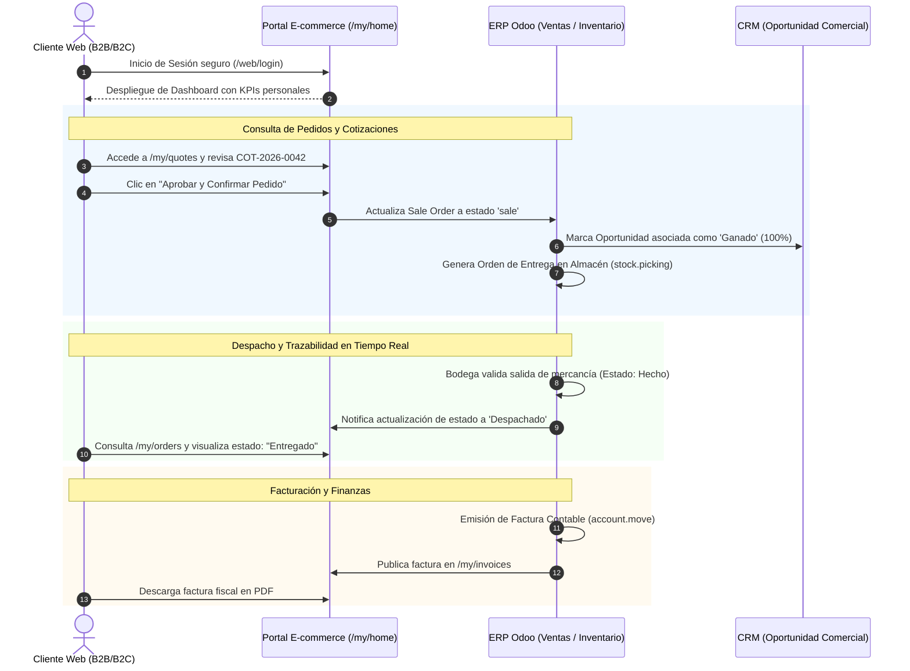

# Especificación de Diseño Funcional y Técnico: Portal de Clientes (Fase 3)

> **Nota de implementación (Fase 3):** la versión final usa **Wix** como
> vitrina/catálogo y un **portal propio en el bridge** (`/portal`) conectado a
> Odoo. El checkout también vive en el bridge (`/checkout`) para que el sitio
> funcione con el **plan gratuito de Wix**, sin Wix Payments. Las rutas `/my/*`
> descritas aquí se agrupan en las pestañas del portal: resumen, cotizaciones,
> pedidos, facturas y perfil. Los estados, campos y reglas de negocio de esta
> especificación se mantienen. Ver `wix/README.md` y `README.md`.

**Proyecto:** Transformación Digital en E-Commerce con ERP, CRM y BI  
**Empresa:** Trebol4Devop  
**Módulo:** Portal de Autoservicio de Clientes B2B / B2C (Odoo Web Portal)  
**Responsable Funcional:** Integrante 3 (CRM) — Jose Emanuel Monzon Lemus  
**Destinatario Técnico:** Integrante 4 (E-commerce / Front-End Web)  
**Fecha:** Octubre 2026 — Fase 3  

---

## 1. Propósito y Alcance del Entregable
Este documento establece las especificaciones funcionales, la arquitectura de información, las reglas de negocio y los flujos de interacción que el **Integrante 4 (E-commerce)** debe implementar dentro de la plataforma web de **Trebol4Devop**.

El objetivo central es dotar a los clientes de Trebol4Devop de un **Portal de Autoservicio (`/my/home`)** seguro, intuitivo y conectado bidireccionalmente con el ERP (Ventas, Inventario y Facturación) y con el CRM (Historial y Seguimiento), garantizando trazabilidad de extremo a extremo sin intervención manual del equipo administrativo.

---

## 2. Arquitectura de Información del Portal (`/my/home`)

El cliente accederá tras autenticarse mediante su correo y contraseña corporativa. La interfaz se estructura en los siguientes bloques funcionales:

```
[Portal de Clientes - /my/home]
 │
 ├── 1. Panel de Resumen (Dashboard KPIs del Cliente)
 │     ├── Cotizaciones Pendientes de Aprobación
 │     ├── Pedidos de Venta Activos / En Ejecución
 │     ├── Facturas Emitidas / Saldo por Pagar
 │     └── Historial de Interacciones (Chatter)
 │
 ├── 2. Módulo de Cotizaciones (/my/quotes)
 │     ├── Listado de Cotizaciones Emitidas
 │     ├── Detalle de Productos, Precios y Descuentos
 │     ├── Botón de Aceptación y Firma Digital en Línea
 │     └── Descarga de Propuesta en PDF
 │
 ├── 3. Módulo de Pedidos de Venta (/my/orders)
 │     ├── Listado de Órdenes Confirmadas (SO-XXXX)
 │     ├── Barra de Progreso y Estados Semafóricos del Pedido
 │     ├── Detalle de Entregas / Albaranes Asociados
 │     └── Descarga de Confirmación de Pedido (PDF)
 │
 ├── 4. Módulo de Facturación y Pagos (/my/invoices)
 │     ├── Listado de Facturas Contables (INV/2026/XXXX)
 │     ├── Estado de Pago (Pagado, Pendiente, En Mora)
 │     ├── Resumen de Impuestos y Totales
 │     └── Descarga de Factura PDF y Documento Electrónico
 │
 └── 5. Perfil Corporativo y Direcciones (/my/account)
       ├── Datos Generales de la Empresa (Razón Social, Contacto, Teléfono)
       ├── Dirección Fiscal / NIT
       └── Libreta de Direcciones de Entrega / Despacho
```

---

## 3. Especificación Detallada de Vistas

### 3.1 Vista Principal: Dashboard del Cliente (`/my/home`)
* **Elementos Visuales Obligatorios:**
  * Tarjetas de acceso rápido (*KPI Badges*) con contadores dinámicos:
    * **Cotizaciones:** `X` presupuestos en espera de aprobación.
    * **Pedidos:** `X` pedidos confirmados o en curso.
    * **Facturas:** `X` facturas pendientes de pago y monto adeudado.
  * Encabezado institucional con bienvenida personalizada: `"Bienvenido, [Nombre de Contacto] — [Nombre de Empresa]"`.
  * Barra de navegación superior persistente con acceso directo al catálogo de E-commerce, carrito de compras y cierre de sesión.

### 3.2 Vista de Cotizaciones (`/my/quotes`)
* **Tabla de Registros:**
  * Columnas: *Número de Cotización* (ej. `COT-2026-0042`), *Fecha de Emisión*, *Válido Hasta*, *Total (Q)*, *Estado*.
* **Estados Permitidos de la Cotización:**
  * `Presupuesto Enviado`: La cotización está lista para revisión.
  * `Aprobada / Confirmada`: El cliente ya validó la cotización y pasó a Orden de Venta.
  * `Expirada`: Superó la fecha de validez sin confirmación.
* **Acciones en Pantalla:**
  * Botón **"Firmar y Pagar" / "Aprobar Cotización"**: Al pulsar, el sistema actualiza inmediatamente el estado en Odoo de `draft/sent` a `sale`.
  * Botón **"Descargar PDF"**: Genera el reporte oficial de cotización de Trebol4Devop.
  * Caja de comentarios (*Chatter*): Permite al cliente enviar dudas sobre la cotización que caen directamente a la oportunidad del CRM.

### 3.3 Vista de Pedidos de Venta y Estado de Entrega (`/my/orders`)
* **Tabla de Registros:**
  * Columnas: *Referencia de Pedido* (ej. `S00003`), *Fecha de Confirmación*, *Productos*, *Monto Total*, *Estado del Pedido*.
* **Semáforo y Trazabilidad del Pedido:**
  El pedido debe reflejar con claridad el avance del flujo:
  1. `Confirmado`: Orden recibida y registrada en el ERP.
  2. `En Preparación`: Albarán de entrega generado en almacén (`stock.picking` en estado *Preparado*).
  3. `Despachado / Entregado`: Salida de almacén validada (`stock.picking` en estado *Hecho*).
  4. `Facturado`: Factura emitida y asociada a la orden.
* **Detalle del Pedido:**
  * Lista de líneas con imagen miniatura del producto, código, descripción, cantidad solicitada y subtotal en Quetzales.

### 3.4 Vista de Facturas Contables (`/my/invoices`)
* **Tabla de Registros:**
  * Columnas: *Número de Factura* (ej. `INV/2026/0001`), *Fecha de Factura*, *Fecha de Vencimiento*, *Monto Original*, *Saldo Pendiente*, *Estado de Pago*.
* **Estados de Factura:**
  * `No Pagado` (Etiqueta amarilla / alerta).
  * `Pagado` (Etiqueta verde de confirmación).
  * `Cancelado` (Etiqueta gris).
* **Acciones:**
  * Visualizador en línea del documento comercial.
  * Botón de descarga en formato PDF.

---

## 4. Diagrama de Flujo y Estados de Interacción (Mermaid)



---

## 5. Reglas de Negocio y Requisitos Técnicos para Integrante 4

1. **Control de Acceso y Aislamiento Multitenant:**
   * El cliente solo debe visualizar órdenes, cotizaciones y facturas vinculadas estrictamente a su `partner_id` (`res.partner`).
   * Ningún usuario del portal puede tener acceso al backend administrativo de Odoo.
2. **Sincronización Automática Bidireccional:**
   * Cuando el vendedor o el sistema modifique un pedido en el ERP, la vista `/my/orders` debe reflejar el cambio en tiempo real al recargar la página.
   * Cualquier nota ingresada por el cliente en el *Chatter* del portal debe registrarse en la bitácora interna de Odoo con notificación al ejecutivo de cuenta.
3. **Diseño Responsivo:**
   * La interfaz del portal debe ser 100% responsiva (Bootstrap / Odoo Website Builder), adaptándose a dispositivos móviles, tablets y escritorios.
4. **Moneda y Formato:**
   * Todos los montos deben expresarse en Quetzales con formato estándar: `Q #,##0.00`.

---

## 6. Mockup Conceptual de la Interfaz (Wireframe de Referencia)

```
+-----------------------------------------------------------------------------------+
|  TREBOL4DEVOP | Catálogo  Servicios  Contacto              [ Mi Cuenta: Carlos M. ]|
+-----------------------------------------------------------------------------------+
|  PORTAL DE AUTOSERVICIO AL CLIENTE                                                |
|  Bienvenido, Ing. Carlos Mendoza (Corporacion TecnoGuate S.A.)                     |
|                                                                                   |
|  +--------------------+  +--------------------+  +--------------------+          |
|  |   COTIZACIONES     |  |   PEDIDOS ACTIVOS  |  |   FACTURAS         |          |
|  |        1           |  |        2           |  |   Q 28,500.00      |          |
|  |  Pendiente Firma   |  |   En Despacho      |  |   1 Pendiente      |          |
|  +--------------------+  +--------------------+  +--------------------+          |
|                                                                                   |
|  ÚLTIMOS MOVIMIENTOS Y ESTADO DE PEDIDOS                                          |
|  +------------+--------------------+------------+--------------+---------------+  |
|  | Referencia | Concepto           | Fecha      | Total        | Estado        |  |
|  +------------+--------------------+------------+--------------+---------------+  |
|  | S00003     | Cluster Kubernetes | 01/10/2026 | Q 28,500.00  | [ Entregado ] |  |
|  | S00001     | Tienda E-commerce  | 25/09/2026 | Q  2,350.00  | [ Facturado ] |  |
|  +------------+--------------------+------------+--------------+---------------+  |
|                                                                                   |
|  ACCIONES RÁPIDAS:                                                                |
|  [ Ver todas las Cotizaciones ]   [ Descargar Facturas ]   [ Contactar a Soporte ] |
+-----------------------------------------------------------------------------------+
```
